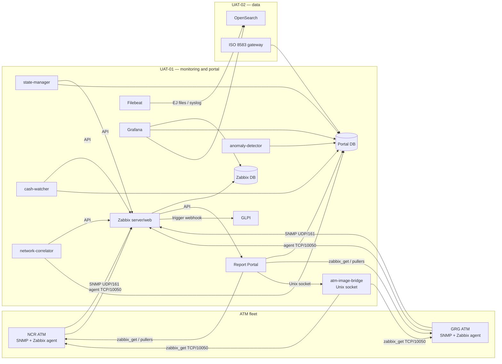

# Dashen Bank ATM Monitoring System — End-to-End Workflow

> **Status:** current UAT workflow
> **Last updated:** 2026-10-31
> **Branch:** `uat-prep`
> **Audience:** monitoring engineers, ATM operations, network/security reviewers, auditors

This document describes how the system works from the moment an ATM is registered
to the moment an operator can see its telemetry, journal, images, state, reports
and tickets. It is the “big picture” companion to the focused runbooks:

- `docs/atm-onboarding.md` — step-by-step onboarding checklist
- `docs/adr-atm-onboarding.md` — why provisioning and identity are shaped this way
- `docs/atm-image-on-demand.md` — image bridge, viewer and security model
- `docs/adr-ej-transport.md` — why EJ is pulled through the agent, not pushed into Zabbix
- `docs/troubleshooting.md` — symptom-based fixes
- `docs/backup-and-restore.md` — backup and restore procedure

---

## 1. What the system does

The platform monitors the bank’s ATM fleet and preserves the evidence needed to
operate and investigate it:

1. **Telemetry** — hardware, cash, network and vendor-specific status from each ATM.
2. **State** — a debounced operator-facing state per ATM (`IN_SERVICE`,
   `UNREACHABLE`, `OUT_OF_CASH`, `HARDWARE_FAULT`, etc.).
3. **Identity** — what the box says it is: vendor, terminal ID, EJ hostname,
   image roots, probe versions, agent version.
4. **Electronic Journal (EJ)** — transaction evidence, searchable and linked to
   images where possible.
5. **Images** — on-demand camera evidence read from the ATM, never stored centrally.
6. **Transactions and cash** — ISO 8583 records, cassette levels and automatic
   cash-load detection.
7. **Operations** — alerts, GLPI tickets, reports, dashboards and audit history.

The design is deliberately **evidence-first**: a host existing in Zabbix is not
the same as an ATM reporting; one fresh item is not the same as the vendor’s
authoritative telemetry arriving; and a green fleet row is not the same as a fully
onboarded ATM.

---

## 2. Design principles

| Principle | What it means in practice |
|---|---|
| **Passive-only ATM channel** | The installer rejects `ServerActive`. Zabbix server/proxy polls the agent on TCP/10050; the ATM never connects to the portal. |
| **Evidence is not authority** | `atm.identity` is stored as evidence in `atm_agent_identity`. It never silently overwrites terminal ID, vendor or model. |
| **One writer per concern** | `provision_atms()` is the only Zabbix provisioning writer. EJ hostname seeding is the one narrow registry write from identity, and only when the field is empty. |
| **Durable convergence** | Saving an ATM writes a provisioning outbox row; a scheduler retries with backoff instead of losing the work in a one-shot thread. |
| **Human gates stay human** | Image-root approval, EJ hostname conflicts, retention/compliance, firewall changes and production signing are deliberate review points. |
| **No central image archive** | Images are streamed from the ATM through the host bridge for one view, then discarded. |
| **Split databases** | Zabbix owns its schema. The portal owns its tables in a separate `portal` database. They are backed up and restored separately. |
| **Unknown is honest** | “Could not read Zabbix” and “no value yet” are different from “not reporting” and are shown as different states. |

---

## 3. Topology

### 3.1 UAT hosts

| Host | Name | IP | Runs |
|---|---|---|---|
| UAT-01 | `dbtcatmmonappuat` | `172.22.10.45` | PostgreSQL, Zabbix server/web/agent, Grafana, GLPI, Report Portal, state-manager, cash-watcher, anomaly-detector, network-correlator, Filebeat, image bridge |
| UAT-02 | `dbtcatmmondbuat` | `172.22.10.60` | OpenSearch, OpenSearch Dashboards, ISO 8583 gateway |

The production target follows the same split: application/monitoring services on
APPS-01, data services on DATA-01, with network rules between VLANs.

### 3.2 Data flow



### 3.3 Component responsibilities

| Component | Responsibility | Reads | Writes |
|---|---|---|---|
| **NCR ATM** | SNMP agent + Zabbix Agent 2. WMI collector for hardware; XFS/identity/image probes where installed. | ATM hardware | — |
| **GRG ATM** | SNMP agent + Zabbix Agent 2. XFS probe for hardware/cassettes; identity/image probes where installed. | ATM hardware | — |
| **Zabbix server** | Polls items, evaluates triggers, stores history, fires webhooks. | SNMP, agent | Zabbix DB |
| **Zabbix web** | Configuration and latest-data UI; API endpoint. | Zabbix DB | Zabbix DB |
| **Report Portal** | Fleet registry, onboarding, agent profiles, identity evidence, EJ journal/search, images, reports, incidents, admin. | Portal DB, Zabbix API, OpenSearch, image bridge | Portal DB, Zabbix API, audit log |
| **state-manager** | Computes `atm_current_state` from Zabbix item values and agent availability; debounces flapping. | Zabbix API, portal DB | `atm_current_state`, `atm_state_history` |
| **cash-watcher** | Detects large single-poll cassette jumps as automatic cash loads. | Zabbix API | `atm_cassette_levels`, `cash_replenishments` |
| **anomaly-detector** | Flags transaction velocity, large amounts, rapid repeats and failure spikes. | `atm_transactions` | `atm_anomalies` |
| **network-correlator** | Pulls network metrics from Zabbix and correlates degradation with transaction failures. | Zabbix API, `atm_transactions` | `atm_network_metrics`, `atm_network_events`, `atm_network_correlation` |
| **Filebeat** | Ships EJ files and syslog to OpenSearch through the `atm_ej_parser` pipeline. | `ej-logs/`, UDP/TCP 514 | OpenSearch |
| **OpenSearch** | Stores searchable EJ evidence with masking and retention. | Filebeat | `atm-ej-live-*` |
| **atm-image-bridge** | Host-side, read-only broker between portal and ATM image files over `zabbix_get`. | Allow-list config, ATM TCP/10050 | Unix socket responses |
| **Grafana** | Dashboards over Zabbix, portal DB and OpenSearch. | Zabbix DB, portal DB, OpenSearch | — |
| **GLPI** | Ticketing, assignment, SLA, RCA. | Zabbix webhook, portal API | GLPI DB |
| **ISO 8583 gateway** | Parses real/simulated switch messages into `atm_transactions`. | Switch TCP feed | Portal DB |

---

## 4. Data domains

| Domain | Primary source | Transport | Authoritative store | Main consumer |
|---|---|---|---|---|
| Hardware / cash / network telemetry | ATM SNMP + agent probes | Zabbix polling | Zabbix DB | Zabbix, state-manager, Grafana, portal |
| ATM identity | `atm.identity` probe | Passive agent item → Zabbix API | `atm_agent_identity` | Portal, fleet report, EJ seeding |
| EJ evidence | ATM journal files / syslog | `zabbix_get` pullers or syslog 514 → Filebeat | OpenSearch + `ej_parse_runs`/`ej_transactions` | EJ Search, EJ Journal, fleet report |
| Images | ATM camera folders/zips | Host bridge → `zabbix_get` chunk keys | Not stored; streamed only | Portal image viewer |
| Transactions | ATM switch / ISO 8583 gateway | TCP feed → parser | `atm_transactions` | Reports, Grafana, anomaly detector, network correlator |
| Cash loads | Cassette jumps in Zabbix | Zabbix API | `cash_replenishments` | Cash pages/reports |
| Operator state | Zabbix item values | Zabbix API | `atm_current_state`, `atm_state_history` | Portal, Grafana |
| Tickets | Zabbix triggers | GLPI webhook | GLPI | Portal incidents, GLPI |
| Audit | Portal actions | Direct write | `audit_log` | Audit page, investigations |

---

## 5. End-to-end ATM onboarding

This is the workflow that turns a row in the inventory into a monitored,
identified, journal-producing, image-capable ATM.

```mermaid
sequenceDiagram
    participant Admin as Portal admin
    participant Portal as Report Portal
    participant PDB as Portal DB
    participant ZBX as Zabbix API
    participant ATM as ATM
    participant FB as Filebeat/OpenSearch

    Admin->>Portal: Register ATM (form / CSV)
    Portal->>PDB: INSERT/UPDATE atm_locations
    Portal->>PDB: Queue atm_provision_state (pending)
    Portal-->>Admin: ATM saved; provisioning queued

    Portal->>PDB: claim due provisioning row
    Portal->>ZBX: host.create / host.update + templates + interfaces
    ZBX-->>Portal: hostid
    Portal->>PDB: status = synced (or retry/blocked)

    Admin->>Portal: Download signed agent profile
    Portal->>PDB: Read registry + approved image roots
    Portal-->>Admin: profile.json + SHA-256
    Admin->>ATM: Run AtmMonitorSetup.exe /ACCEPTATM=...
    ATM->>ATM: Write config, probes, roots; start Agent 2
    ATM-->>Zabbix: passive items become available

    ZBX->>ATM: poll atm.parts / atm.xfs.* / atm.identity
    Portal->>ZBX: identity_sync every 5 min
    Portal->>PDB: store atm_agent_identity + conflicts
    Portal->>PDB: seed empty ej_hostname (journal filename only)

    ATM->>FB: EJ files/syslog
    FB->>FB: mask PANs, parse, index
    Portal->>PDB: ingest_ej_shadow → ej_parse_runs/ej_transactions

    Admin->>Portal: Approve image roots
    Portal->>PDB: store image_roots
    Portal-->>Admin: new profile includes atm.image.* keys
    Admin->>ATM: Reapply profile if roots changed

    Portal->>Portal: Fleet health: provisioning/reporting/identity/EJ/images
```

### Phase 0 — Network and firewall

Before the ATM can be monitored:

- NCR: TCP 10050 (agent), TCP 3389 (RDP for installation; remove/limit after).
- GRG: UDP 161 (SNMP) and TCP 10050 if the agent/XFS/identity/image probes are used.
- EJ: the monitoring host must reach the ATM on TCP 10050 for `zabbix_get`, or the ATM must forward syslog to UAT-01 UDP/TCP 514.
- Images: the host bridge must reach the ATM on TCP 10050.

A “firewall rule created” email is not proof. The proof is a live `zabbix_get`,
SNMP walk, or `verify.py` result.

### Phase 1 — Register the ATM

The registry row is the source of truth for:

- `atm_id` (also the Zabbix technical host name)
- vendor (`NCR` or `GRG`)
- model, branch, district, city, region, coordinates
- IP address, terminal ID, EJ hostname/format
- approved image roots
- status (`active` / `inactive`)

Ways to register:

1. Portal **ATM Registration** form.
2. Portal **Onboard ATM** wizard (facts → pre-flight → provision → verify).
3. CSV import.
4. Bulk Excel/CSV import for the initial fleet.

Saving the row does **not** mean the ATM is onboarded. It queues the durable
provisioning outbox row.

### Phase 2 — Provision the Zabbix host

`provision_atms()` is the single writer. It:

1. Loads the registry row.
2. Plans the host: create, update, skip, review (unknown vendor/model) or no-IP.
3. Links the shared **Dashen Bank ATM Agent** template.
4. Links the vendor template:
   - NCR: WMI Parts + SNMP
   - GRG: GRG XFS + SNMP
5. Adds both interfaces:
   - SNMP `:161`
   - Zabbix agent `:10050` (needed for XFS, identity, WMI and image items)
6. Writes the result to `atm_provision_state`.

The scheduler’s `provision_worker` runs every **60 seconds**:

- `pending` → claim → `syncing` → `synced`
- transient failure → `retry` with exponential backoff (1 minute → 1 hour)
- missing IP / unknown vendor → `blocked` (not retried forever)
- stale `syncing` older than 15 minutes → reclaimed

The Agent setup page shows **Synced / Retrying / Needs registry change** and has
**Retry provisioning now**.

### Phase 3 — Build and apply the agent profile

The portal builds a deterministic, signed profile from the registry row and the
agent manifest:

- Agent 2 configuration: passive only, `Server=`, `Hostname=`, `ListenPort=10050`
- UserParameters for the vendor collector, identity, XFS and image probes
- Probe files with SHA-256 and version
- Approved image roots and `C:\monitor\atm-image-roots.txt`
- EJ hostname and format
- HMAC signature (`ATM_PROFILE_SECRET`)

The installer (`AtmMonitorSetup.exe`):

1. Validates the profile signature and every probe hash.
2. Writes `C:\monitor` files and the Zabbix agent include.
3. Installs/updates Zabbix Agent 2 6.4.
4. Writes the passive-only config.
5. Starts the service, with bounded retries for the Agent 2 6.4 `ZBX-25530`
   startup crash.
6. Runs the identity/vendor checks as the agent’s service account (`SYSTEM`).
7. Writes `atm-agent-state.json` and `verify-*.json`.

The installer never re-implements policy. It writes the profile’s own text and
verifies the result.

### Phase 4 — Prove reporting

`verify.py` / `verify_atm()` answers: **is this ATM actually reporting?**

It reads Zabbix and the portal row and checks:

- Does the host exist and is it enabled?
- Does it have an agent interface?
- Are the vendor’s **authoritative keys** arriving and fresh?
  - NCR: `atm.parts`
  - GRG: `atm.xfs.cdm.device_status` + cassette count, or legacy SNMP keys
- Are items unsupported?
- Is another authoritative source stale (partial telemetry outage)?

Verdicts:

| Verdict | Meaning |
|---|---|
| `reporting` | Vendor telemetry is fresh within the window. |
| `provisioned_not_reporting` | Host exists, but nothing fresh is arriving. |
| `not_provisioned` | No Zabbix host with that technical name. |
| `unknown` | Zabbix could not be read; reporting is unverified. |

The fleet page treats provisioning problems as the cause and reporting as the
symptom, so the cause sorts first.

### Phase 5 — Identity

`atm.identity` is a passive Zabbix agent item on the shared
**Dashen Bank ATM Agent** template. It runs hourly and reports:

- vendor and vendor source
- terminal ID and terminal source
- EJ hostname, source, roots and newest file
- image roots and candidates
- probe SHA-256/version
- agent version and config hash
- the full `profile_hash` and the `deploy_hash` of the files/config the installer wrote (and when)
- IP addresses, serial, model, computer name

The portal’s `identity_sync` job runs every **5 minutes**:

1. `host.get` + `item.get` for the fleet in batches.
2. Reads the item’s `lastvalue` (not history).
3. Validates with `atm_identity.parse`.
4. Stores in `atm_agent_identity` with `received_by='zabbix:auto'`.
5. Recomputes conflicts against the current registry row.
6. If `ej_hostname` is empty **and** the source is `ej-filename`, seeds it.

Identity is evidence, not authority. High/medium conflicts (vendor, terminal ID,
EJ hostname) require human review. Low-severity drift (model, IP) is shown but
does not block onboarding.

### Phase 6 — EJ collection

EJ has two ingestion paths; both end in the same OpenSearch pipeline and the same
portal journal tables.

**Path A — pull through the agent (primary in this repo)**

- `scripts/ej_pull_targets.py` resolves eligible ATMs from the portal DB:
  active, correct vendor, IP present, `ej_hostname` present.
- NCR: `scripts/pull_ej_logs.sh` calls
  `zabbix_get -s <ip> -k "vfs.file.contents[E:\\EJLogs\\<file>]"`.
- GRG: `scripts/pull_grg_ej_logs.py` reads `EJ<yymmdd>.log` from the configured
  GRG log directory and writes the canonical local name.
- Both write `ej-logs/<date>_<HOST>_EJDATA.log` and raw evidence under
  `ej-logs/raw/`.
- Filebeat watches `*_EJDATA.log`, applies the `atm_ej_parser` pipeline (PAN
  masking before storage), and writes `atm-ej-live-*` in OpenSearch.
- `scripts/ingest_ej_shadow.py` parses the same files into
  `ej_parse_runs` and `ej_transactions` for the portal’s EJ Journal.

**Path B — ATM forwards syslog**

- The ATM sends EJ lines to UAT-01 UDP/TCP 514.
- Filebeat’s syslog inputs apply the same `atm_ej_parser` pipeline.
- This path is useful when the monitoring host cannot pull from the ATM.

EJ hostname rules:

- The registry `ej_hostname` names the local evidence file and maps it back to the ATM.
- An empty value is seeded only from the journal filename (`ej-filename` source).
- An existing value is never overwritten; a mismatch is a conflict for a human.

### Phase 7 — Images

Images are **on demand**, never stored centrally.

1. A human approves image roots on **Agent setup**. Approval changes the agent
   profile, so a profile reapply is required.
2. The profile writes `atm.image.*` UserParameters and
   `C:\monitor\atm-image-roots.txt`.
3. The host bridge has its own allow-list
   (`/etc/atm-monitoring/atm-image-bridge.json`), separate from the agent roots.
4. The portal sends an ATM id, day and HMAC locator to the bridge over a Unix socket.
5. The bridge preflights TCP/10050, calls `zabbix_get` with
   `atm.image.dir`, `atm.image.info`, `atm.image.chunk`,
   `atm.image.ziplist` or `atm.image.zipentry`.
6. The bridge verifies size/SHA-256 or zip CRC, masks filenames, and streams the
   bytes back through the portal for one view.
7. The portal writes an audit record and sends `Cache-Control: no-store`.

The identity probe also reports the `deploy_hash` the installer recorded in
`C:\monitor\atm-agent-state.json`. That hash covers exactly what was written to
the box — the agent config, probes, include and roots file — and deliberately
ignores informational fields such as the EJ hostname. The portal rebuilds the
current profile from the registry and compares the deploy hashes. If they
differ — or the box cannot report one — the Images stage stays **Reapply
needed** even when every root the old profile exposes is approved. This is what
catches the dangerous case: a newly approved root is absent from the box, but
the old profile’s roots are a subset of the allow-list, so a root-only
comparison would look green. The full `profile_hash` is still recorded as audit
evidence for the whole signed document.

The image viewer working does **not** prove the onboarding Images stage is ready:
the viewer uses the host bridge allow-list; the onboarding stage uses the
registry’s approved `image_roots`, the identity-reported roots, and the applied
deploy hash.

### Phase 8 — Fleet onboarding state and acceptance

The **Fleet health** page combines five evidenced stages per ATM:

| Stage | Ready when |
|---|---|
| **Provisioning** | Zabbix host exists and the dry-run plan has no pending change |
| **Reporting** | Vendor authoritative telemetry is fresh |
| **Identity** | `atm.identity` is under 24h old and has no high/medium conflict |
| **EJ** | EJ hostname is set and the latest parsed journal is today or yesterday |
| **Images** | Every reported root is approved **and** the box’s applied `deploy_hash` matches the current profile |

The overall status is the worst stage. The **next action** is the first stage
that is not ready in that order. `unknown` means the sweep could not evaluate a
stage; it never sends a technician to a box.

An ATM is **Onboarded** only when all five are ready. Reporting telemetry alone
is not enough.

---

## 6. Runtime workflows

### 6.1 Telemetry and operator state

1. Zabbix polls each ATM’s SNMP and agent items.
2. Triggers evaluate thresholds and create problems.
3. `state-manager` polls Zabbix every 30 seconds for each active ATM:
   - vendor status keys
   - cassette levels
   - XFS keys
   - `atm.parts` and `atm.part.*` for NCR WMI
   - agent interface availability
4. It debounces a new state for 3 consecutive polls before writing it.
5. It updates `atm_current_state` and closes/opens `atm_state_history` segments.
6. Portal pages and Grafana read the state; the portal shows the eight NetXMS
   states with matching colours.

State rules:

- `availability == 2` → `UNREACHABLE`
- `availability == 1` and no usable telemetry → `UNKNOWN` (collector may be missing)
- Zabbix API failure → leave the last known state unchanged, do not invent an outage
- Registered but absent in Zabbix → `NOT_PROVISIONED`

### 6.2 EJ search and journal

- **EJ Search** queries OpenSearch (`atm-ej-live-*`) for live/full-text evidence.
- **EJ Journal** queries the portal’s `ej_parse_runs` / `ej_transactions` for
  parsed sessions, files, warnings and per-ATM status.
- Both mask card data. The OpenSearch pipeline scrubs PANs before storage; the
  portal display scrub is defence in depth.
- The EJ Journal page shows parse errors, latest journal date, and links to raw
  evidence and images.

### 6.3 Image evidence

See Phase 7. The key separation:

| Layer | Allow-list | Purpose |
|---|---|---|
| Agent profile | `atm_locations.image_roots` | Which roots the agent may expose through `atm.image.*` |
| Host bridge | `/etc/atm-monitoring/atm-image-bridge.json` | Which ATM ids, IPs, vendors and roots the bridge may read |
| Viewer | Portal RBAC + audit | Who may request evidence |

A root must be approved in the registry **before** a profile reapply; otherwise
the new profile omits the image keys and the viewer loses its transport.

### 6.4 Transactions, cash, anomalies and network correlation

- **Transactions** arrive from the ISO 8583 gateway (real switch or simulator)
  into `atm_transactions`.
- `txn_source_policy` decides which sources are visible; `atm_transactions_visible`
  is the view the portal and reports query, so simulated rows cannot leak into
  production reporting.
- **cash-watcher** reads cassette levels from Zabbix every 5 minutes and records
  a `cash_replenishments` row when a single poll jumps by at least 200 notes.
- **anomaly-detector** scans transactions every 60 seconds for velocity, large
  amounts, rapid repeats and failure spikes; writes `atm_anomalies`.
- **network-correlator** reads network metrics from Zabbix every 120 seconds,
  writes `atm_network_metrics`, and correlates degradation windows with
  transaction failures in `atm_network_events` / `atm_network_correlation`.

### 6.5 Reports and scheduler

The portal scheduler is a singleton across gunicorn workers (file lock). It runs:

| Job | Interval | Purpose |
|---|---|---|
| Schedule poller | 30s | Check cron schedules; email reports |
| Provisioning worker | 60s | Claim due `atm_provision_state` rows |
| Identity sync | 300s | Read `atm.identity` from Zabbix |
| Retention sweep | daily at 00:00 UTC | Delete transactions/audit/state rows past retention |

Reports are generated as PDF/Excel/CSV from the portal DB and can be scheduled,
emailed, or downloaded on demand. The fleet report is cached in
`fleet_report_cache` because a full Zabbix sweep is expensive; the cache has a
15-minute TTL and a heartbeat so a dead sweep can be reclaimed.

### 6.6 Ticketing

1. Zabbix trigger fires (severity ≥ High).
2. The **GLPI Ticket** media type calls the GLPI API.
3. GLPI creates a ticket in the mapped category, with the mapped team and SLA.
4. On recovery, Zabbix adds a follow-up and moves the ticket to **Pending**.
5. Tickets are **not auto-closed**; an engineer documents RCA before closing.
6. The portal’s Incident Management page reads GLPI and keeps local read/seen
   state (`ticket_seen`).

### 6.7 Fleet health

`fleet_report.py` joins:

- `verify_atm()` verdicts and facts
- the provisioning dry-run plan
- `atm_agent_identity`
- `ej_parse_runs`
- approved `image_roots`

It produces one row per ATM, worst first, with the five stages and one next
action. The result is cached in `fleet_report_cache` and rendered by
`/admin/onboard/fleet`. The CSV export is the rollout tracker.

---

## 7. Data model and ownership

### 7.1 Portal-owned tables

| Table | Purpose |
|---|---|
| `atm_locations` | Registry: ATM id, vendor, model, location, IP, terminal id, EJ hostname/format, status, image roots. |
| `atm_provision_state` | Durable provisioning outbox and last outcome. |
| `atm_agent_identity` | Observed identity evidence, conflicts, probe/agent versions. |
| `atm_current_state` | Current operator state per ATM. |
| `atm_state_history` | Closed/open state segments for availability. |
| `atm_transactions` | Transaction records from the switch/gateway. |
| `atm_transactions_visible` | View filtered by `txn_source_policy`. |
| `txn_source_policy` | Which transaction sources are visible in reports. |
| `ej_parse_runs` | One row per parsed journal file/hash, including errors. |
| `ej_transactions` | Parsed EJ transactions linked to parse runs. |
| `ej_parse_latest` | Latest parse summary view/table. |
| `atm_anomalies` | Detector findings and acknowledgement state. |
| `atm_network_metrics` | Network latency/loss/jitter samples. |
| `atm_network_events` | Degradation windows. |
| `atm_network_correlation` | Transaction impact per network event. |
| `atm_cassette_levels` | Last cassette levels for cash-load detection. |
| `cash_replenishments` | Manual and automatic cash loads. |
| `fault_type_map` | Vendor fault code → human-readable fault mapping. |
| `app_users` | Portal users, roles, password hashes. |
| `audit_log` | Admin actions, profile downloads, image views, identity ingest. |
| `scheduled_reports` | Report schedules, recipients, last run. |
| `fleet_report_cache` | Cached fleet sweep with heartbeat. |
| `atm_delete_archive` | Archived deleted ATM rows. |
| `ticket_seen` | Portal read/seen state for GLPI tickets. |
| `portal_schema_version` | Portal schema marker used by DB split/backup. |

### 7.2 Zabbix-owned tables

Zabbix owns its own schema (`hosts`, `items`, `triggers`, `history`, `trends`,
`users`, `interfaces`, etc.). These are never copied into the portal database and
must not be edited directly.

### 7.3 Database split

- Zabbix DB: `zabbix`
- Portal DB: `portal` (`PORTAL_DB_NAME`)
- Backup/restore uses `config/portal_tables.txt` as the single list of portal
  tables. `scripts/split_portal_db.sh` copies them between databases.
- The Stage-3 probe (`scripts/probe_portal_db.py`) verifies the split.

---

## 8. Security, compliance and trust boundaries

| Boundary | Control |
|---|---|
| ATM → Zabbix | Passive agent checks on TCP/10050; SNMP UDP/161. No `ServerActive`. |
| ATM → portal | No direct path. The portal never accepts an ATM connection. |
| Portal → Zabbix | API user with least privilege; credentials in `.env`. |
| Portal → image bridge | Unix socket, bearer token ≥32 chars, read-only mount, group permission. |
| Bridge → ATM | `zabbix_get` TCP/10050, allow-listed ATM/roots, HMAC locators. |
| Portal → OpenSearch | Network path from UAT-01 to UAT-02; index pattern and pipeline. |
| Zabbix → GLPI | Media type credentials; rotating one side requires the other. |
| Profile | HMAC signature with `ATM_PROFILE_SECRET`; installer verifies probes and signature. |
| Card data | OpenSearch pipeline masks PANs before storage; portal scrubs on display. |
| Images | No central archive; one view at a time; audit record; `no-store`. |
| Audit | `audit_log` records admin changes, profile downloads, identity ingest, image views. |
| RBAC | Admin vs operator roles; onboarding, agent, users, schedules and audit are admin-only. |

Human gates:

1. **Image-root approval** — a human decides which folders an ATM may expose.
2. **EJ hostname conflict** — a mismatch is shown, never auto-healed.
3. **Terminal ID / vendor conflict** — identity evidence is not authority.
4. **Compliance/retention** — EJ/image retention and lawful basis.
5. **Firewall/network** — TCP/10050, UDP/161, syslog 514.
6. **Production signing** — `ATM_PROFILE_SECRET` and signed release process.

---

## 9. Failure modes and diagnostics

| Symptom | Meaning | First check |
|---|---|---|
| Fleet row `not_provisioned` | No Zabbix host with that technical name | `docker exec report-portal python3 verify.py <ATM>` |
| Fleet row `provisioned_not_reporting` | Host exists, no fresh vendor telemetry | The blocker names the missing key; check TCP/10050 or UDP/161 |
| Provisioning `retry` | Transient Zabbix/API failure | Agent setup → Retry provisioning now; portal logs |
| Provisioning `blocked` | No IP or unknown vendor | Fix the registry row |
| Identity `no_item` | Host not linked to the shared Agent template | Sync to Zabbix / retry provisioning |
| Identity `unsupported` | Agent config lacks `UserParameter=atm.identity` | Reapply the current profile |
| Identity `no_value` | Item exists, no value collected yet | Check agent reachability; Refresh from Zabbix |
| Identity `stale` | Last value >24h old | Check the agent on the box |
| Identity `rejected` | Invalid identity document | Read the rejection reason; do not overwrite the registry |
| EJ `pending` | No journal ingested | `python3 scripts/ej_pull_targets.py --explain` |
| EJ `stale` | Latest journal older than yesterday | Check the pull cron and the ATM journal path |
| EJ `review` | Parse errors on the latest journal | Open EJ Journal, fix the parser/input |
| Images `pending` | Waiting for identity, no approved root, or the box runs an older profile | Approve roots; download and reapply the current profile |
| Images `review` | Reported root not approved | Approve on Agent setup, then reapply profile |
| Viewer “Image bridge not configured” | Portal lacks token or cannot see the socket | Check `ATM_IMAGE_BRIDGE_TOKEN`, socket, GID |
| Viewer “ATM agent unreachable” | TCP/10050 preflight failed | Check ATM power/link/agent |
| State `UNREACHABLE` | Zabbix agent interface unavailable | Network/power/agent |
| State `UNKNOWN` | Zabbix says agent available but no usable telemetry | Collector not installed or keys unsupported |
| Fleet page “recomputing” forever | Sweep claim stale or worker died | Recompute now; check portal logs/heartbeat |
| Scheduler not running | Lock held by another worker or app failed | Check logs for “Scheduler already running” |

Useful commands:

```bash
# Container health
docker compose ps
docker compose logs --tail=120 report-portal
curl -fsS http://localhost:8888/health

# One ATM
docker exec report-portal python3 verify.py ATM-TEST-NCR

# Fleet report, read-only
docker exec -i report-portal python3 - <<'PY'
from verify import fleet
out = fleet()
print(out['counts'])
for row in out['rows']:
    print(row['atm_id'], row['onboarding_status'],
          {k: v['status'] for k, v in row['stages'].items()})
PY

# Identity
docker exec report-portal python3 -c \
  "from identity_sync import sync_one; print(sync_one('ATM-TEST-NCR'))"

# Direct agent checks
zabbix_get -s <ATM-IP> -k atm.identity
zabbix_get -s <ATM-IP> -k atm.parts
zabbix_get -s <ATM-IP> -k "vfs.file.contents[E:\\EJLogs\\<file>]"

# EJ targets
python3 scripts/ej_pull_targets.py --explain
python3 scripts/ej_pull_targets.py --vendor GRG --explain

# Image bridge
systemctl status atm-image-bridge --no-pager
sudo journalctl -u atm-image-bridge -n 50 --no-pager
sudo ls -l /run/atm-image-bridge/bridge.sock
```

---

## 10. Day-2 operations

### 10.1 Deploy a code change

```bash
cd /data/atm-monitoring
git pull --ff-only origin uat-prep
docker compose restart report-portal        # code-only change; source is bind-mounted
```

Use `up -d --force-recreate` when changing `.env`, mounts, groups or ports:

```bash
docker compose up -d --force-recreate report-portal
```

Use `--build` when changing the Dockerfile or dependencies:

```bash
docker compose up -d --build report-portal
```

### 10.2 Health checks

```bash
docker compose ps
curl -fsS http://localhost:8888/health
curl -fsS http://localhost:8888/ready
bash scripts/uat_preflight.sh
python3 scripts/check_jobs.py
```

### 10.3 Add one ATM

1. Register it (form or onboarding wizard).
2. Confirm **Zabbix provisioning = Synced** on Agent setup.
3. Approve image roots **before** downloading the profile.
4. Download and apply the profile.
5. Run `verify.py <ATM>` and `sync_one('<ATM>')`.
6. Confirm EJ target resolution and journal arrival.
7. Recompute Fleet health; all five stages should become ready.

### 10.4 Backups and retention

- `scripts/backup_db.sh` dumps the portal tables listed in `config/portal_tables.txt`.
- `scripts/backup_configs.sh` backs up configuration.
- `scripts/split_portal_db.sh --verify` checks the portal/Zabbix split.
- Portal retention deletes old transactions, audit rows and closed state segments daily.
- OpenSearch ISM policy retains EJ indices per compliance decision (currently 90 days in UAT).

### 10.5 Template and probe changes

- Generate/import the shared agent template:
  `python3 scripts/import_agent_template_api.py --link-all`
- Vendor templates:
  `python3 scripts/import_wmi_template_api.py`
  `python3 scripts/import_grg_xfs_template_api.py --no-link`
- Rebuild the agent manifest after probe changes:
  `python3 scripts/build_agent_manifest.py`
- The shared **Dashen Bank ATM Agent** template is the only owner of
  `atm.identity`; vendor templates must not define it.

### 10.6 Change control

- Database changes go through `scripts/` migrations and `config/portal_tables.txt`.
- Zabbix template changes are exported/imported through the API scripts, not
  hand-edited XML.
- Image roots and EJ hostname changes are audited.
- Production signing and secret rotation are separate change records.

---

## 11. Current UAT snapshot — 2026-10-31

This is a point-in-time status, not part of the workflow contract.

| Item | State |
|---|---|
| Portal code | `1a2c16e` — five-stage fleet onboarding |
| Fleet hosts | 3: `ATM-TEST-NCR`, `ATM-TEST-GRG`, `TEST` |
| `ATM-TEST-NCR` | Reporting OK, EJ OK, image viewer working; identity pending (older agent profile); image roots approved |
| `ATM-TEST-GRG` | EJ OK; agent unreachable (~21.6h stale, ping and TCP/10050 timeout); identity pending; image root approved |
| `TEST` | Lab laptop, no NCR hardware; reporting/identity/EJ pending — not a production target |
| Image bridge | Active; socket `/run/atm-image-bridge/bridge.sock`; portal GID 1001; NCR viewer verified |
| Profile signing | `ATM_PROFILE_SECRET` set on UAT |
| Known gate | NCR profile reapply and GRG agent reachability must pass before the two-box pilot |

The next workflow step for UAT is: reapply the current NCR profile, confirm
identity and image keys, restore the GRG agent, then rerun the fleet report until
both real ATMs show all five stages ready.

---

## 12. Related documents

| Document | Why read it |
|---|---|
| `docs/atm-onboarding.md` | Operator checklist for one new ATM |
| `docs/adr-atm-onboarding.md` | Provisioning/identity design and consequences |
| `docs/atm-image-on-demand.md` | Image bridge deployment, security and troubleshooting |
| `docs/adr-ej-transport.md` | Why EJ is pulled, not pushed into Zabbix |
| `docs/portal-db-split.md` | Portal/Zabbix database split |
| `docs/backup-and-restore.md` | Backup and restore |
| `docs/troubleshooting.md` | Symptom-based fixes |
| `docs/uat-pilot-checklist.md` | UAT readiness and acceptance |
| `docs/Production_Migration_Guide_v2.md` | Production cutover |

---

## 13. Glossary

| Term | Meaning |
|---|---|
| **ATM** | Automated Teller Machine. |
| **NCR / GRG** | The two ATM vendors in the fleet. |
| **EJ** | Electronic Journal — the ATM’s transaction/event log. |
| **XFS** | Extensions for Financial Services — the ATM hardware interface. |
| **WMI** | Windows Management Instrumentation; used by the NCR collector. |
| **TID** | Terminal ID; maps ISO 8583 field 41 to the ATM. |
| **PAN** | Primary Account Number; always masked before storage. |
| **Outbox** | `atm_provision_state`; durable queue of provisioning work. |
| **Reconciler** | Scheduler worker that retries due outbox rows. |
| **Evidence** | Observed data (identity, EJ, images) that informs but does not overwrite the registry. |
| **Human gate** | A decision that must be made by a person (image roots, conflicts, retention, signing). |
| **Fleet stage** | One of provisioning, reporting, identity, EJ, images. |
